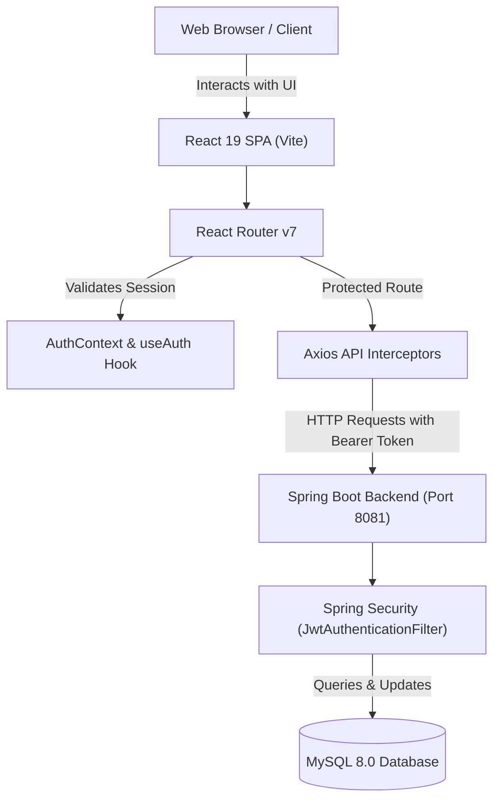
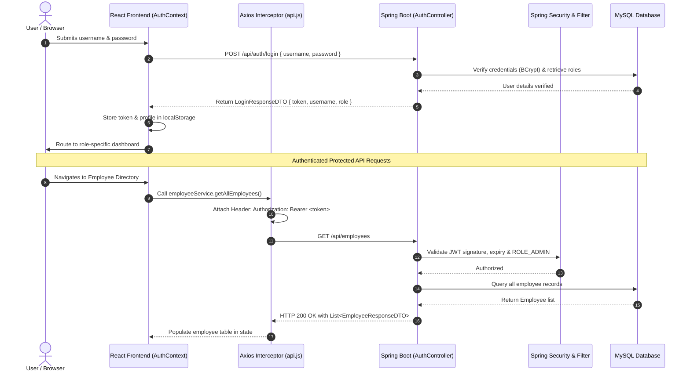

# Employee Management System - Frontend Application

A responsive, production-ready React 19 single-page application (SPA) built with Vite, Axios, and React Router. This project connects to an existing Spring Boot 4 / Java 21 backend with JWT authentication, role-based authorization (`ROLE_ADMIN` and `ROLE_EMPLOYEE`), and MySQL persistence.

---

## 1. Project Overview

The **Employee Management System (EMS)** frontend provides a modern SaaS-style user experience for enterprise workforce management. It supports role-differentiated dashboards, complete employee CRUD operations, real-time client-side search, department filtering, pagination, and persistent session state using secure JWT Bearer authorization.

### Key Capabilities
- **Stateless Authentication**: Login and registration with client-side validation, password visibility toggle, and instant feedback.
- **Two-Tier Route Guards**: Custom `ProtectedRoute` (authentication check) and `RoleBasedRoute` (authority check) protecting administrative assets.
- **Admin Command Center**: Real-time workforce metrics (Total Headcount, Unique Departments, Average Salary, Payroll Total), searchable and filterable directory, employee creation, record updates, and modal deletion confirmations.
- **Employee Portal**: Dedicated workspace for employees displaying user account details, role permissions, and active session lifetime.
- **Responsive Layout**: Fluid UI supporting mobile drawers, desktop sidebars, adaptive metric grids, and horizontal-scrolling data tables.
- **Independent Deployability**: Configured for hosting on **Vercel** or **Netlify**, communicating with a separately hosted backend (e.g. Render, Railway, AWS).

---

## 2. Technology Stack

| Layer | Technology | Details |
|---|---|---|
| **Framework / Library** | React 19 | Modern hooks (`useState`, `useEffect`, `useContext`, `useCallback`, `useMemo`) |
| **Build Tool & Bundler** | Vite 6 | Fast HMR and Rollup production bundling |
| **Routing** | React Router v7 | SPA declarative routing, nested guards, redirect handlers |
| **HTTP Client** | Axios 1.7+ | Centralized instance with automatic Bearer token interceptor |
| **Styling** | Modular Modern CSS | Custom CSS variables, responsive design, no heavy bulky UI dependencies |
| **Language** | JavaScript (ESM) | Clean modern JavaScript (ES2022+) |

---

## 3. Architecture Diagrams

### 3.1 Application Architecture



### 3.2 JWT Authentication & Session Lifecycle Flow



---

## 4. Folder Structure

```
employee-management-frontend/
├── public/
│   ├── favicon.svg
│   ├── icons.svg
│   └── _redirects              # SPA rewrite rule for Netlify
├── src/
│   ├── assets/                 # SVGs and brand images
│   ├── components/             # Reusable UI components
│   │   ├── ConfirmDialog.jsx   # Accessible modal for delete confirmations
│   │   ├── DashboardLayout.jsx # Layout shell with responsive sidebar & navbar
│   │   ├── EmployeeTable.jsx   # Data table with currency formatting & actions
│   │   ├── ErrorMessage.jsx    # Alert error banners
│   │   ├── Loading.jsx         # Loading spinner
│   │   ├── Navbar.jsx          # Top bar with role badge & sign-out
│   │   ├── ProtectedRoute.jsx  # Unauthenticated access guard
│   │   ├── RoleBasedRoute.jsx  # Role-restricted route guard
│   │   └── Sidebar.jsx         # Responsive navigation sidebar & mobile drawer
│   ├── context/
│   │   └── AuthContext.jsx     # Centralized authentication & token state
│   ├── hooks/
│   │   └── useAuth.js          # Hook for consuming authentication context
│   ├── pages/
│   │   ├── AddEmployee.jsx     # Employee creation form
│   │   ├── AdminDashboard.jsx  # Workforce metrics & management overview
│   │   ├── EditEmployee.jsx    # Employee update form
│   │   ├── EmployeeDashboard.jsx# Employee self-service workspace
│   │   ├── EmployeeList.jsx    # Searchable, filterable, paginated directory
│   │   ├── Login.jsx           # User sign-in
│   │   ├── NotFound.jsx        # 404 page
│   │   ├── Profile.jsx         # User identity & JWT session claims
│   │   └── Register.jsx        # User account registration
│   ├── routes/
│   │   └── AppRoutes.jsx       # Route declarations & landing redirects
│   ├── services/
│   │   ├── api.js              # Centralized Axios instance & interceptors
│   │   ├── authService.js      # Auth API endpoints integration
│   │   └── employeeService.js  # Employee CRUD endpoints integration
│   ├── styles/
│   │   ├── auth.css            # Styles for authentication cards & forms
│   │   ├── dashboard.css       # Styles for sidebar, navbar, metrics, drawer
│   │   ├── employee.css        # Styles for tables, search toolbar, pagination
│   │   └── global.css          # Theme variables, buttons, badges, modals
│   ├── utils/
│   │   ├── roleUtils.js        # Role normalization and check helpers
│   │   └── tokenUtils.js       # Safe base64url token decoding & storage
│   ├── App.jsx                 # App root with Router & AuthProvider
│   └── main.jsx                # React DOM render entry point
├── .env                        # Local development variables (Git-ignored)
├── .env.example                # Environment variable documentation
├── .gitignore                  # Git exclusions (node_modules, .env, dist)
├── index.html                  # HTML5 root template
├── package.json                # Project dependencies and scripts
├── vercel.json                 # SPA rewrite rule for Vercel
├── vite.config.js              # Vite configuration
└── README.md                   # Complete system documentation
```

---

## 5. Prerequisites & Installation

### Prerequisites
- **Node.js**: `v18.x` or higher (verified with `v24.20.0`)
- **npm**: `v9.x` or higher (verified with `11.19.0`)
- **Running Backend**: Spring Boot backend running on `http://localhost:8081`

### Installation Steps

1. Clone or navigate to the repository directory:
   ```bash
   cd D:\JWT_Project\employee-management-frontend
   ```

2. Install dependencies:
   ```bash
   npm install
   ```

3. Configure your local environment:
   Copy `.env.example` to `.env`:
   ```bash
   cp .env.example .env
   ```
   Verify `VITE_API_BASE_URL` is set:
   ```env
   VITE_API_BASE_URL=http://localhost:8081
   ```

4. Run development server:
   ```bash
   npm run dev
   ```
   Open your browser to: **`http://localhost:5173`**

---

## 6. Environment Variables

| Variable | Description | Local Default | Production Example |
|---|---|---|---|
| `VITE_API_BASE_URL` | Base URL of the Spring Boot backend API | `http://localhost:8081` | `https://api.your-domain.com` |

> [!IMPORTANT]
> Vite prefixes environment variables with `VITE_` to expose them to the browser client. Never place private keys, database passwords, or JWT secrets in frontend environment files.

---

## 7. Backend REST API Endpoints Contract

All endpoints correspond to the Spring Boot backend contract:

| Feature | HTTP Method | Endpoint | Authorization / Role |
|---|---|---|---|
| **Register User** | `POST` | `/api/auth/register` | Public (`permitAll()`) |
| **Login User** | `POST` | `/api/auth/login` | Public (`permitAll()`) |
| **Get All Employees** | `GET` | `/api/employees` | `ROLE_ADMIN` required |
| **Get Employee by ID** | `GET` | `/api/employees/:id` | `ROLE_ADMIN` required |
| **Create Employee** | `POST` | `/api/employees` | `ROLE_ADMIN` required |
| **Update Employee** | `PUT` | `/api/employees/:id` | `ROLE_ADMIN` required |
| **Delete Employee** | `DELETE` | `/api/employees/:id` | `ROLE_ADMIN` required |

---

## 8. Role-Based Access Control (RBAC)

The application models two distinct roles:

1. **Administrator (`ROLE_ADMIN`)**:
   - Access to Admin Dashboard (`/admin/dashboard`).
   - Access to Employee Directory (`/employees`).
   - Ability to create (`/employees/new`), edit (`/employees/edit/:id`), and delete employee records.
   - Profile management (`/profile`).

2. **Employee (`ROLE_EMPLOYEE`)**:
   - Access to Employee Workspace (`/employee/dashboard`).
   - Profile inspection (`/profile`).
   - Restricted from workforce administration. Attempting to navigate to `/employees` or `/admin/*` automatically redirects back to `/employee/dashboard` with an informative access notification.

---

## 9. Production Build & Deployment

### 9.1 Build Locally
Run the production build command:
```bash
npm run build
```
The optimized bundle will be compiled into the `dist/` directory.

To test the production build locally:
```bash
npm run preview
```

---

### 9.2 Deploy to Vercel
1. Push your code to your GitHub repository: `https://github.com/ApurvaChothe07/employee-management-frontend.git`.
2. Log in to [Vercel](https://vercel.com) and click **"Add New Project"**.
3. Import your frontend repository.
4. Set the **Framework Preset** to **Vite**.
5. In **Environment Variables**, add:
   - `VITE_API_BASE_URL` = `https://your-backend-domain.com`
6. Click **Deploy**. SPA routing rewrites are pre-configured in [`vercel.json`](file:///D:/JWT_Project/employee-management-frontend/vercel.json).

---

### 9.3 Deploy to Netlify
1. Log in to [Netlify](https://netlify.com) and select **"Add new site"** -> **"Import an existing project"**.
2. Select your GitHub repository.
3. Build Settings:
   - **Build command**: `npm run build`
   - **Publish directory**: `dist`
4. In **Site configuration** -> **Environment variables**, add:
   - `VITE_API_BASE_URL` = `https://your-backend-domain.com`
5. Click **Deploy Site**. SPA routing fallback is handled automatically by [`public/_redirects`](file:///D:/JWT_Project/employee-management-frontend/public/_redirects).

---

### 9.4 Backend Production Requirements (Render / Railway)
When hosting the Spring Boot backend separately:
1. Ensure the backend database URL points to your managed cloud MySQL database.
2. In `SecurityConfig.java`, include your deployed frontend URL in `allowedOrigins`:
   ```java
   configuration.setAllowedOrigins(List.of(
       "http://localhost:5173",
       "https://your-app.vercel.app",
       "https://your-app.netlify.app"
   ));
   ```
3. Use HTTPS for both frontend and backend in production.

---

## 10. Troubleshooting & FAQ

| Problem | Likely Cause | Solution |
|---|---|---|
| **CORS error in browser console** | Backend does not permit origin | Verify `SecurityConfig.java` allows `http://localhost:5173` or your production domain. |
| **Redirected to `/login?expired=true`** | JWT has expired (1 hour default) | Sign in again with valid credentials to obtain a new token. |
| **403 Forbidden when clicking Employees** | Logged in as standard Employee | Log in with an Administrator account (`ROLE_ADMIN`). Standard employees do not have CRUD clearance. |
| **"Unknown database" in backend log** | MySQL database not created | Execute `CREATE DATABASE IF NOT EXISTS employee_management;` in MySQL. |
| **White page on refresh on hosted site** | Missing SPA rewrite rule | Ensure `vercel.json` or `public/_redirects` is deployed with your project. |

---

## 11. Available NPM Scripts

- `npm run dev`: Launch local Vite development server with HMR.
- `npm run build`: Compile and minify production bundles into `dist/`.
- `npm run preview`: Preview the production build locally on port 4173.
